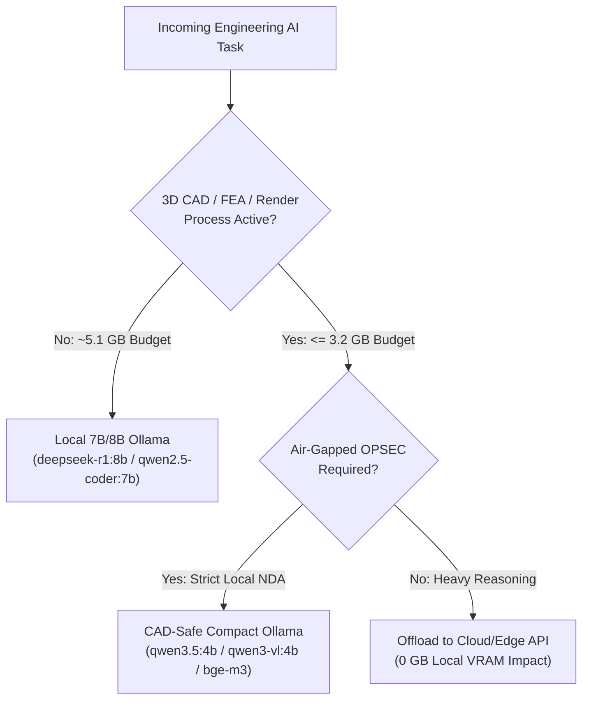

# Hybrid Local AI Router — CAD-Safe VRAM Orchestrator

[](https://github.com/LeonardoNardiko/hybrid-local-ai-router/actions/workflows/ci.yml)
[](pyproject.toml)
[](LICENSE)
[](https://tecnopro.me)

Deterministic, zero-dependency Python router designed for **engineering workstations with constrained GPU VRAM (e.g., 6 GB – 8 GB)** that run heavy 3D CAD/BIM/FEA software alongside local **Ollama** LLMs/VLMs.

---

## The Engineering Problem

Loading an 8B-parameter LLM (`~4.9 GB VRAM`) while **SOLIDWORKS**, **Autodesk Inventor**, **Siemens Solid Edge**, **FreeCAD**, **CalculiX**, or **Blender Cycles** is open causes OpenGL/Vulkan viewport stalls or `CUDA Out of Memory` crashes. Conversely, sending confidential BOMs or customer drawings to cloud APIs violates industrial OPSEC.

`hybrid-local-ai-router` enforces deterministic VRAM budgets and air-gapped OPSEC policies:



---

## Quick Start & Tests

```bash
git clone https://github.com/LeonardoNardiko/hybrid-local-ai-router.git
cd hybrid-local-ai-router
python -m unittest discover -s tests -v
```

```python
from hybrid_ai_router import HybridCadAiRouter

router = HybridCadAiRouter(total_vram_gb=6.0, cad_reserved_vram_gb=2.8)
decision = router.select_route(
    task_capability="code",
    running_processes=["SLDWORKS.exe"],
    airgapped_opsec=True,
)
print(decision.selected.model_id, "->", decision.reason)
# qwen3.5:4b -> Selected sovereign local model 'qwen3.5:4b' (3.1GB) under CAD-safe local budget.
```

---

## Author

**Leonardo de Lima Junior (Leonardo Nardiko)** — Industrial Software Architect & Multidisciplinary Engineer  
🌐 [nardiko.me](https://nardiko.me) · ⚙️ [tecnopro.me](https://tecnopro.me)
